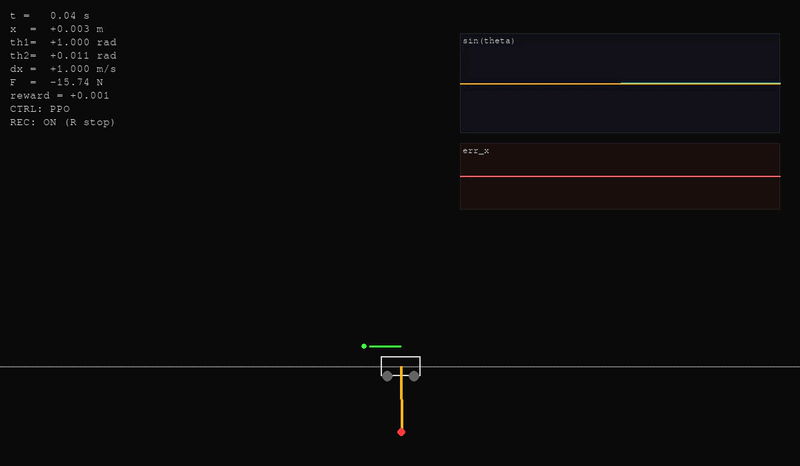

# Управление перевёрнутым маятником

Проект для моделирования и управления тележкой с перевёрнутым маятником. В
состав входят физическая модель на C++, датчики с шумом и квантованием,
Gymnasium-среда, контроллер PPO и GUI на Pygame.

## Демо



## Возможности

- симуляция одно- и двухзвенного маятника;
- физическое ядро на C++ с Python-интерфейсом;
- PPO-обучение через Stable-Baselines3;
- настраиваемые награды, условия завершения и усечения эпизода;
- телеметрия с шумом, разрешением энкодеров и фильтрацией;
- визуализация, ручное управление и запись видео;
- автоматические тесты, Ruff и mypy.

## Структура

- [`packages/experiment.py`](packages/experiment.py) — описание эксперимента
  `ExperimentConfig` и фабрики сред;
- [`packages/presets.py`](packages/presets.py) — пресеты конфигураций
  (единый источник правды для всех точек входа);
- [`packages/simulation/co`](packages/simulation/co) — физика (C++/pybind11),
  датчики, разметка наблюдений и конфигурации (см. README пакета);
- [`packages/simulation/env`](packages/simulation/env) — Gymnasium-среда;
- [`packages/controllers/base`](packages/controllers/base) — интерфейс
  контроллера, награды и условия завершения/усечения эпизода;
- [`packages/controllers/ppo`](packages/controllers/ppo) — PPO: инференс
  (`PPOController`) и обучение (`PPOTrainer`);
- [`packages/simulation/gui`](packages/simulation/gui) — визуализация
  на Pygame;
- [`tests`](tests) — тесты;
- [`PPO_train.py`](PPO_train.py) — обучение, [`run_gui.py`](run_gui.py) — GUI,
  [`plot_creator.py`](plot_creator.py) — headless-графики,
  [`train_and_evaluate_4_agents.py`](train_and_evaluate_4_agents.py) —
  сравнение агентов с разной вероятностью старта в верхней точке.

## Установка

Требуется Python 3.12, Poetry, CMake и C++-компилятор.

```bash
poetry install --no-root
```

## Запуск

Сначала собрать физическое ядро:

```bash
make build
```

Все команды есть в едином CLI (корневые скрипты — тонкие обёртки над ним):

```bash
poetry run python -m packages train --help
poetry run python -m packages gui                      # визуализация
poetry run python -m packages plot --runs 20           # график cos(theta1)
poetry run python -m packages eval --model checkpoints/ppo/pendl
poetry run python -m packages profile --duration 5     # профилирование ядра
```

То же через make:

```bash
make train   # обучение PPO
make gui     # визуализация
make plot    # headless-график прогона
make eval    # метрики прогона + график
```

## Проверки

```bash
make check   # ruff + mypy + pytest
```

По отдельности: `make lint`, `make typecheck`, `make test`, `make format`.
Те же проверки гоняет CI (`.github/workflows/ci.yml`) на каждый push.

## Воспроизводимость

- `ExperimentConfig.seed` (по умолчанию 42) сдвигается на ранг в пуле
  сред — одинаковый запуск даёт одинаковые траектории;
- `env.reset(seed=...)` сеет начальное состояние, шум датчиков и шум силы;
- датчики по умолчанию **идеальные** (`SensorConfig.exact_mode = True`):
  точные углы и скорости из физики. Честные датчики — флаг
  `exact_mode = False`: квантование энкодеров, шум, оценка скоростей
  дифференцированием, ФНЧ;
- чекпоинты, обученные при другом режиме датчиков, несопоставимы —
  при смене `exact_mode` модель переобучается (`make train`).

## Лицензия

MIT, см. [LICENSE](LICENSE).

Основные параметры модели, датчиков, контроллера и PPO — в
[`packages/presets.py`](packages/presets.py) (единый источник правды);
описание эксперимента целиком —
[`packages/experiment.py`](packages/experiment.py).
